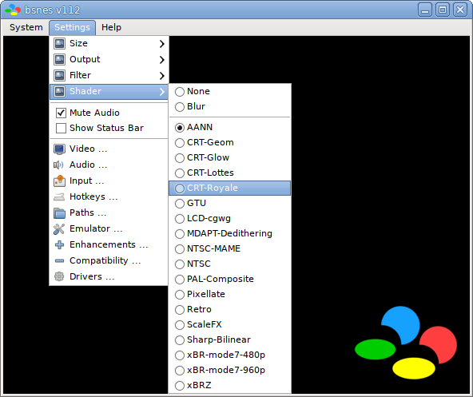
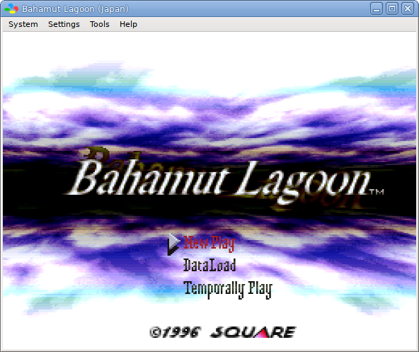
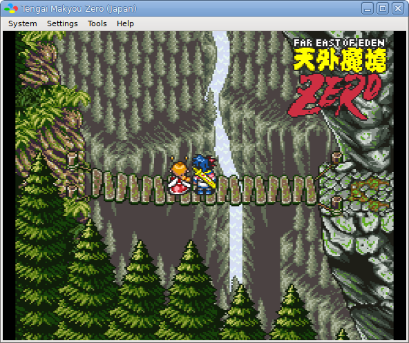

bsnes-fastlink
==============


bsnes-fastlink is a Windows/Vulkan-focused fork of bsnes tuned for standard
play and speedrun practice, with the priority on reducing input-to-photon
latency while preserving the core SNES emulation behavior.

This fork is based on bsnes, originally developed by Near.

Latest FastLink Changes
-----------------------

The latest play-testing changes from `Play-testing v1` center the Windows build
around the low-latency path:

  - Added the native `Win32 Vulkan` video backend and made it the default on
    Windows.
  - Added selectable Vulkan present behavior (`Immediate`, `Mailbox`, `FIFO`)
    and configurable swapchain image count for queue-depth control.
  - Added the native `Win32 Raw Input` backend with a dedicated high-priority
    input thread, atomic keyboard/controller state, and RetroUSB controller
    mapping.
  - Added the FastLink RAM Trace localhost HTTP service on `127.0.0.1:9000`,
    serving 128 KiB WRAM snapshots with CORS headers for the Spectra prototype.
  - Updated WASAPI defaults for shared-mode, nonblocking, 48000 Hz output so
    other programs can keep using the sound device.
  - Added FastLink configuration keys for RAM Trace, run-ahead requests,
    non-Windows input polling, thread affinity, timer resolution, software frame
    pacing, and low-latency defaults.
  - Enabled HD Mode 7 defaults in this fork: scale defaults to 4x, perspective
    correction is on, mosaic handling is on, and supersampling is off by default
    for speed.
  - Disabled shader/software-filter defaults on the Windows fast path to avoid
    extra frame work.
  - Removed the old Direct3D 9 runtime path from this fork's Windows build.

Run-Ahead Status
----------------

`FastLink/RunAhead` is exposed in the config and clamped to 0-4 frames generally
(1-4 on Windows). The
x64 Windows build uses libco's serializable Win64 coroutine backend, allowing
deterministic run-ahead states without relying on opaque Windows fiber stacks.
Discarded fast-PPU frames also suppress rasterization inside the core, avoiding
HD Mode 7 work for frames that will never be presented.
The audio stream resamplers are restored with each run-ahead state so
speculative samples cannot create waveform discontinuities in committed audio.

On Windows the low-latency profile enforces a minimum of one run-ahead frame;
older configuration files containing `FastLink/RunAhead: 0` are normalized to
`1` when loaded.

Frame pacing occurs immediately before core execution so the event-driven
Win32 Raw Input thread can publish controller changes until the latest safe
point before the SNES polls its controller ports.

The native Vulkan driver waits for upload ownership and a swapchain image
before core execution rather than dropping a newly emulated frame. Its true
fullscreen path requests `VK_EXT_full_screen_exclusive` when supported, with a
borderless fullscreen fallback on drivers that do not expose the extension.

RAM Trace HTTP API
------------------

RAM Trace is controlled by `FastLink/RAMTraceServer` in the config. When
enabled, the service listens on localhost port `9000` and returns a raw 128 KiB
WRAM snapshot suitable for local tools such as
`research/snes9x-fastlink/fastlink-spectra/prototype.html`.

The service uses a separate low-priority thread, short socket timeouts,
`TCP_NODELAY`, and triple-buffered snapshots so local HTTP reads do not stall the
emulation frame path.

Windows Defaults
----------------

On Windows, this fork normalizes old or unsafe settings back to the FastLink
runtime path:

  - Video driver: `Win32 Vulkan`
  - Video present mode: `Mailbox` by default when available
  - Video swapchain images: clamped to 2-4
  - Audio driver: WASAPI when available
  - Audio exclusive mode: disabled for WASAPI shared-device compatibility
  - Audio blocking: disabled
  - Native file dialogs: enabled
  - PPU fast path: enabled
  - Software filters: disabled by default on the fast path

Unique Features
---------------

  - True Super Game Boy emulation (using the SameBoy core by Lior Halphon)
  - HD mode 7 graphics with optional supersampling (by DerKoun)
  - Low-level emulation of all SNES coprocessors (DSP-n, ST-01n, Cx4)
  - Multi-threaded PPU graphics renderer
  - Speed mode settings which retain smooth audio output (50%, 75%, 100%, 150%, 200%)
  - Built-in games database with thousands of game entries
  - Built-in cheat code database for hundreds of popular games (by mightymo)
  - Built-in save state manager with screenshot previews and naming capabilities
  - Customizable per-byte game mappings to support any cartridges, including prototype games
  - 7-zip decompression support
  - Extensive Satellaview emulation, including BS Memory flash write and wear-leveling emulation
  - Optional higan game folder support (standard game ROM files are also fully supported!)
  - Advanced mapping system allowing multiple bindings to every emulated input

Standard Features
-----------------

  - MSU1 support
  - BPS and IPS soft-patching support
  - Save states with undo and redo support (for reverting accidental saves and loads)
  - OpenGL multi-pass pixel shaders
  - Several built-in software filters, including HQ2x (by MaxSt) and snes_ntsc (by blargg)
  - Adaptive sync and dynamic rate control for perfect audio/video synchronization
  - Just-in-time input polling for minimal input latency
  - Vulkan-focused low-latency video output on Windows
  - Shared-mode WASAPI audio path for low-latency playback while other programs keep audio access
  - Low-latency Win32 Raw Input path
  - Selectable unknown-device HID mapping via `FastLink/GenericHIDMapping`
  - Localhost RAM Trace HTTP service for external practice tooling
  - Periodic auto-saving of game saves
  - Sprite limit disable support
  - Cubic audio interpolation support
  - Optional high-level emulation of most SNES coprocessors
  - Optional emulation of flaws in older emulators for compatibility with older unofficial software
  - CPU, SA1, and SuperFX overclocking support
  - Frame advance support
  - Screenshot support
  - Cheat code search support
  - HiDPI support
  - Multi-monitor support
  - Turbo support for controller inputs

Build
-----

The Windows build is produced from Linux with:

```sh
./build_windows.sh build
```

The build script writes `build_win/bsnes.exe` and copies the result to
`/mnt/PhantomIDE/bsnes.exe` by default.

Links
-----

  - [Official git repository](https://github.com/bsnes-emu/bsnes)
  - [Official Discord](https://discord.gg/B27hf27ZVf)

Preview
-------




